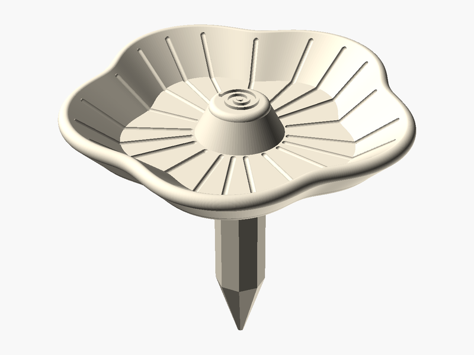

# Pollinator Waterer

**Created by:** Elsie

All sorts of bugs that are important to the ecosystem can use this to get water. Water is important to pollinators when it is dry, and this helps them find it right next to your plants.

Bees butterflies and other pollinators carry pollen from flower to flower which helps plants make fruit and seeds. When water is close by they don't have to fly far for a drink.

## Printed with PHA 🌱

**What is PHA?** PHA is a plastic made by tiny microbes! They munch on plant sugars and oils and store the PHA inside their bodies, kind of like how we store energy.

**Why is it eco-friendly?** It comes from plants instead of oil. And when it's all done, it can break down back into nature (in soil, and even in the ocean) instead of hanging around for hundreds of years.

**Printing tips:**
- 🧊 **Keep it cool:** set the nozzle to about 190–200 °C.
- 💨 **Lots of air:** turn the cooling fan up high and leave the printer doors or lid open.
- 🐢 **Go a little slower:** slower prints help each layer stick and cool nicely.
- ☀️ **Keep it dry:** store the spool in a bag with a desiccant pack so it doesn't soak up water.
